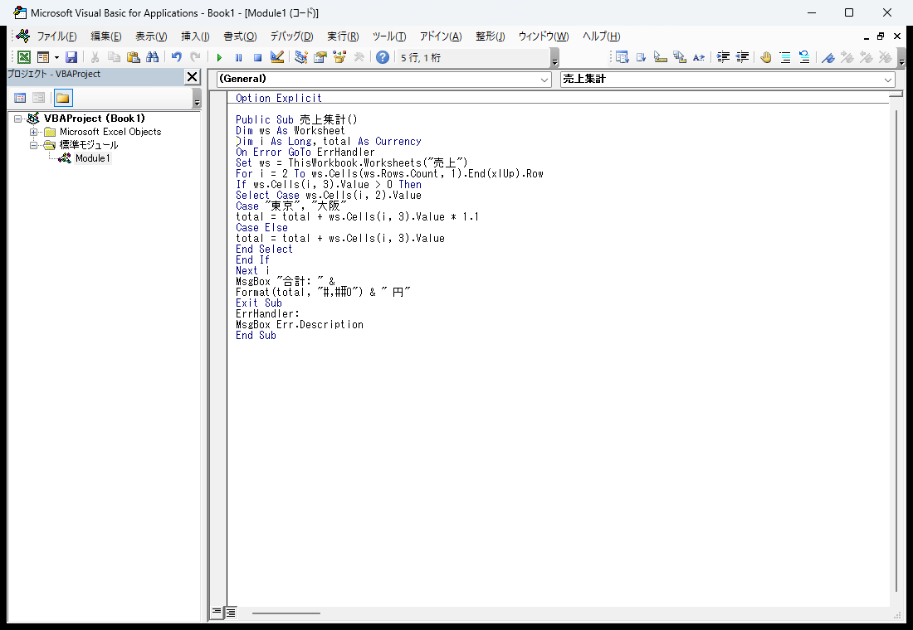
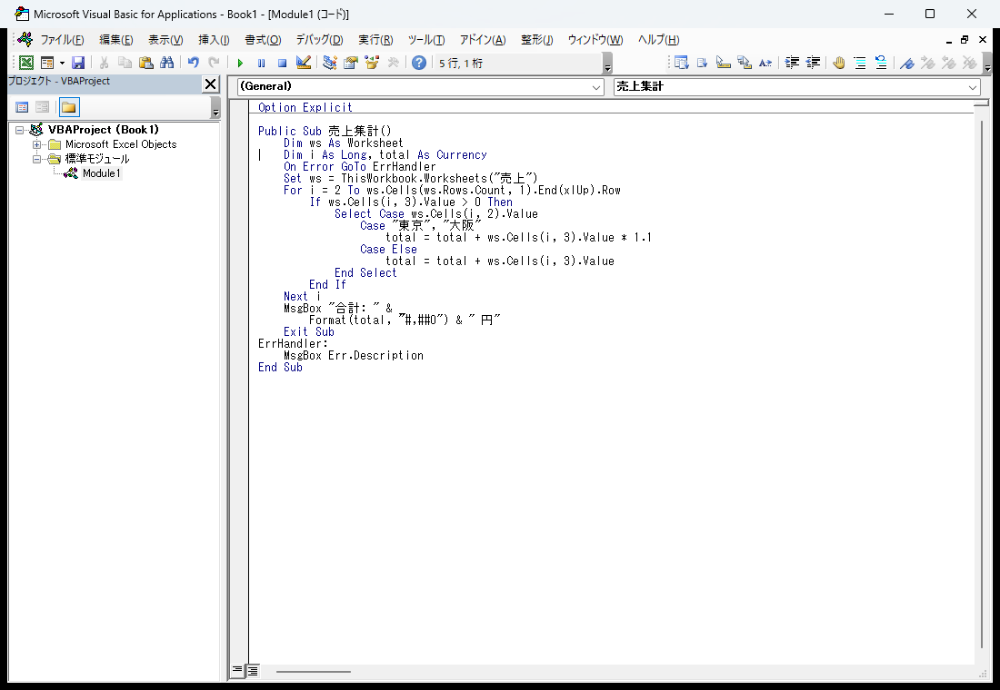

# SnapIndenter

[](https://github.com/alineapps/SnapIndenter/releases/latest)
[](LICENSE)

**Loads in a snap. Indents in a snap.** A lightweight code indenter for the VBA editor (VBE) — re-indent your Excel / Access VBA code with a single keystroke.

[日本語 README](README.md)

| Before | After (`Ctrl+Shift+F`) |
|---|---|
|  |  |

> The user interface is available in **English and Japanese**. It follows your Office display language by default; you can change it in the settings dialog.

## Features

- **A free alternative to Smart Indenter**: focused on the indentation features most people need.
- **Fast and small**: a single ~60 KB DLL. It doesn't slow down Office startup the way Rubberduck can.
- **Works inside the VBE**: run it from the menu bar, the code window's context menu, or a keyboard shortcut.
- **Easy install**: just run `install.bat`. No admin rights needed, and you don't have to enable "Trust access to the VBA project object model".
- **32-bit and 64-bit Office**: works in Excel, Access, Word and any other host with a VBE.
- **Never changes the line count**: only leading whitespace changes, so breakpoints stay where they are.

## Download and install

1. Download `SnapIndenter-x.y.z.zip` from [Releases](https://github.com/alineapps/SnapIndenter/releases/latest).
2. Close all Office applications.
3. Right-click the zip → **Properties** → check **Unblock** at the bottom of the General tab → **OK**.
4. Extract the zip and double-click `install.bat`.
5. Start Excel or Access and press `Alt+F11`. A new **SnapIndenter** menu appears in the VBE menu bar.

> If you skip step 3, Windows may show a "Windows protected your PC" warning. Click **More info** → **Run anyway** to continue.

To uninstall, run `uninstall.bat`.

**Requirements**: Windows 10 / 11, .NET Framework 4.8 (built into Windows), Office 2010 or later (including Microsoft 365)

## Usage

| Action | Menu item | Default shortcut |
|---|---|---|
| Indent the procedure at the cursor (or the selected lines) | SnapIndenter → Indent Procedure / Selection | `Ctrl+Shift+F` |
| Indent the current module | SnapIndenter → Indent Module | (assignable) |
| Indent every module in the active project | SnapIndenter → Indent All Modules in Project | |
| Undo the last indent | SnapIndenter → Undo Last Indent | |
| Settings (with live preview, language) | SnapIndenter → Settings... | |

The same commands are also in the code window's right-click menu.

Note: the VBE's own `Ctrl+Z` can't undo changes made by add-ins. Use "Undo Last Indent" instead.

## What it formats

- Indents `Sub` / `Function` / `Property`, `If` / `ElseIf` / `Else`, `Select Case` / `Case`, `For` / `Next`, `Do` / `Loop`, `While` / `Wend`, `With`, `Type`, `Enum` and `#If` blocks.
- Single-line `If x Then y` statements are not treated as blocks.
- Line labels and line numbers stay in column 1.
- Continuation lines (` _`) keep their position relative to the first line.
- Keywords inside strings and comments are ignored.

You can change the indent width, use tabs, choose whether `Case` is indented, set shortcuts, switch the UI language and more in the settings dialog.
The full specification is in [docs/仕様書.md](docs/仕様書.md) (Japanese).

## Building from source

Requirements: .NET SDK 10 or later, and the Office interop assemblies (installed into the GAC with Office).

```powershell
.\build.ps1      # test → Release build → dist\SnapIndenter-x.y.z.zip
```

If the interop assemblies aren't in the GAC, put `Microsoft.Vbe.Interop.dll` and `office.dll` in a folder and build with
`dotnet build src\SnapIndenter.AddIn -c Release -p:OfficeInteropDir=C:\path\to\dlls`.

Bug reports and feature requests are welcome in [Issues](https://github.com/alineapps/SnapIndenter/issues). If something gets indented incorrectly, please include a code sample.

## License

[MIT License](LICENSE)
