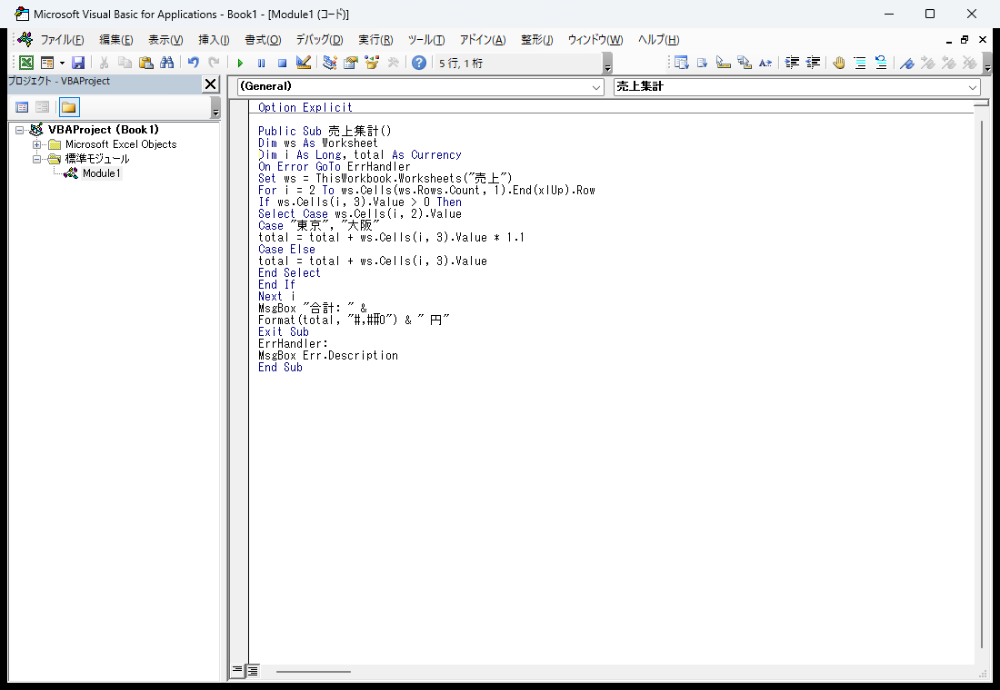
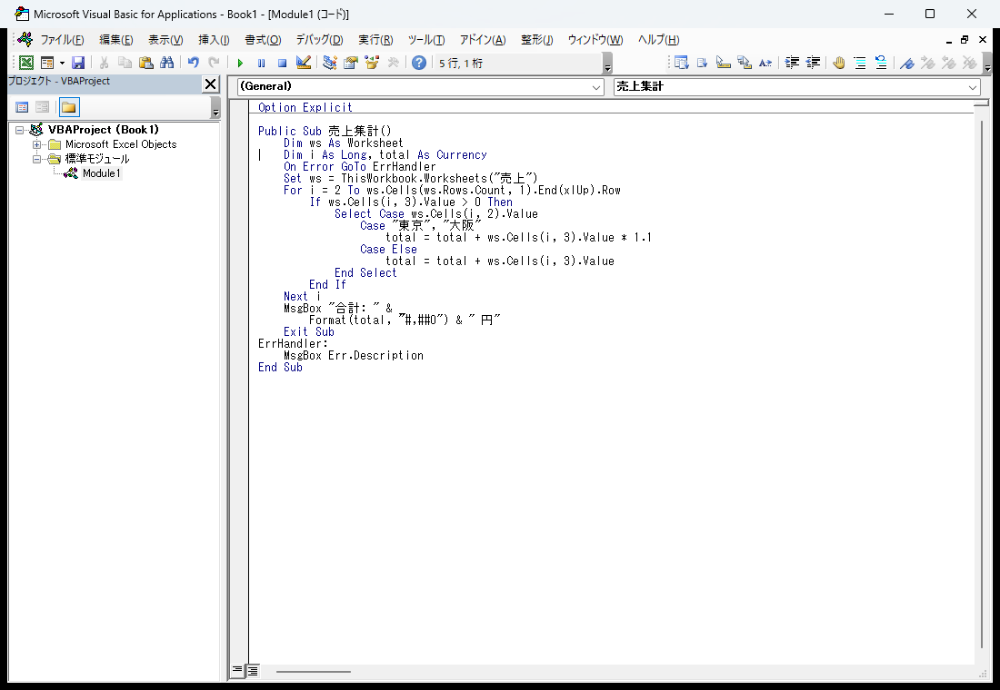

# SnapIndenter

[](https://github.com/alineapps/SnapIndenter/releases/latest)
[](LICENSE)

**一瞬で起動して、一瞬で整う。** Excel / Access の VBA コードを、VBE（Visual Basic Editor）からショートカットキー 1 つでインデント整形する軽量アドインです。

[English README](README.en.md)

| 整形前 | 整形後（`Ctrl+Shift+F`） |
|---|---|
|  |  |

## 特長

- **SmartIndenter の代替として使える無料のインデント整形**：SmartIndenter が有償化されたため、同程度の機能に絞って自作しました。
- **軽い**：DLL 1 つ（約 60KB）。Rubberduck のように Office の起動を待たせません。
- **VBE から直接操作**：メニュー、右クリックメニュー、ショートカットキーから実行できます。
- **インストールが簡単**：`install.bat` を実行するだけ。管理者権限も、「VBA プロジェクト オブジェクト モデルへのアクセスを信頼する」の設定も不要です。
- **32bit / 64bit 版 Office 対応**：Excel、Access、Word など VBE を持つアプリで使えます。
- **行数を変えない**：インデントだけを直すので、ブレークポイントの位置もずれません。

## ダウンロードとインストール

1. [Releases](https://github.com/alineapps/SnapIndenter/releases/latest) から `SnapIndenter-x.y.z.zip` をダウンロードします。
2. Excel / Access など Office をすべて終了します。
3. zip を右クリック →「プロパティ」→「全般」タブ下部の **「許可する」** にチェックを入れて「OK」を押します。
4. zip を展開し、`install.bat` をダブルクリックします。
5. Office を起動して `Alt+F11` で VBE を開くと、メニューバーに **整形(J)** が追加されています。

> 手順 3 を省くと、実行時に「Windows によって PC が保護されました」などの警告が出ることがあります。その場合は「詳細情報」→「実行」で続行できます。

アンインストールは `uninstall.bat` を実行します。旧名称「Kanna for VBA」「VBA Formatter」から移行する場合も、`install.bat` を実行するだけで旧版は自動で削除されます。

**動作環境**：Windows 10 / 11、.NET Framework 4.8（Windows に標準搭載）、Office 2010 以降（Microsoft 365 を含む）

## 使い方

| 操作 | メニュー | 既定のショートカット |
|---|---|---|
| カーソル位置のプロシージャを整形（複数行を選択しているときは選択範囲） | 整形 → プロシージャ/選択範囲を整形 | `Ctrl+Shift+F` |
| 表示中のモジュール全体を整形 | 整形 → モジュールを整形 | （設定で割り当て可） |
| アクティブなプロジェクトの全モジュールを整形 | 整形 → プロジェクト全体を整形 | |
| 直前の整形を元に戻す | 整形 → 直前の整形を元に戻す | |
| 設定（プレビュー付き） | 整形 → 設定 | |

コード ウィンドウの右クリックメニューからも実行できます。

※ VBE の `Ctrl+Z` ではアドインによる変更を戻せません。「直前の整形を元に戻す」を使ってください。

## 整形内容

- `Sub` / `Function` / `Property`、`If` / `ElseIf` / `Else`、`Select Case` / `Case`、`For` / `Next`、`Do` / `Loop`、`While` / `Wend`、`With`、`Type`、`Enum`、`#If` に合わせてインデントします。
- 1 行 If（`If x Then y`）はブロックとして扱いません。
- 行ラベル・行番号は 1 桁目に置きます。
- 行継続（` _`）の 2 行目以降は、1 行目からの相対位置を保ったまま移動します。
- 文字列やコメントの中のキーワードは無視します。

インデント幅、タブの使用、`Case` をインデントするかどうか、ショートカットキーなどは設定画面で変更できます。詳しくは [仕様書](docs/仕様書.md) を参照してください。

## 開発

```
src/SnapIndenter.Core     整形エンジン（Office に依存しない。netstandard2.0）
src/SnapIndenter.AddIn    VBE 用 COM アドイン（net48。Core のソースも取り込んで SnapIndenter.dll にする）
tests/SnapIndenter.Tests  整形エンジンの単体テスト（xUnit）
installer/         インストール・アンインストール用スクリプト
docs/              仕様書
```

```powershell
.\build.ps1      # テスト → Release ビルド → dist\SnapIndenter-x.y.z.zip を作成
```

ビルドには .NET SDK 10 以降と、Office の相互運用アセンブリ（Office をインストールすると GAC に入ります）が必要です。詳しくは [仕様書の 11 章](docs/仕様書.md#11-ビルドテスト配布開発者向け) を参照してください。

不具合報告や要望は [Issues](https://github.com/alineapps/SnapIndenter/issues) へお願いします。整形が崩れる場合は、該当するコードの例を添えていただけると助かります。

## ライセンス

[MIT License](LICENSE)
